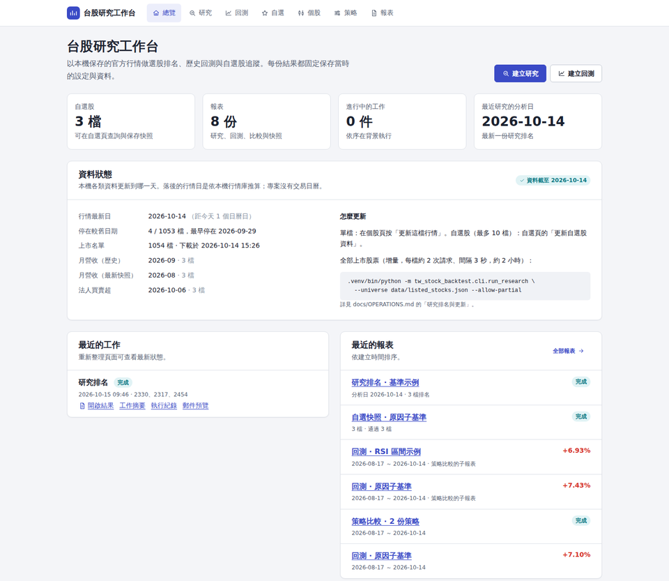
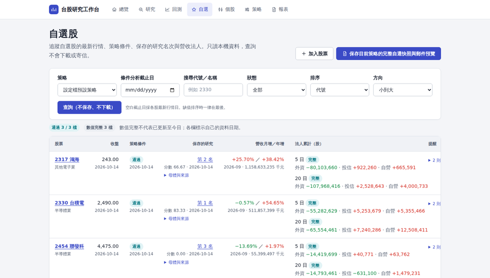
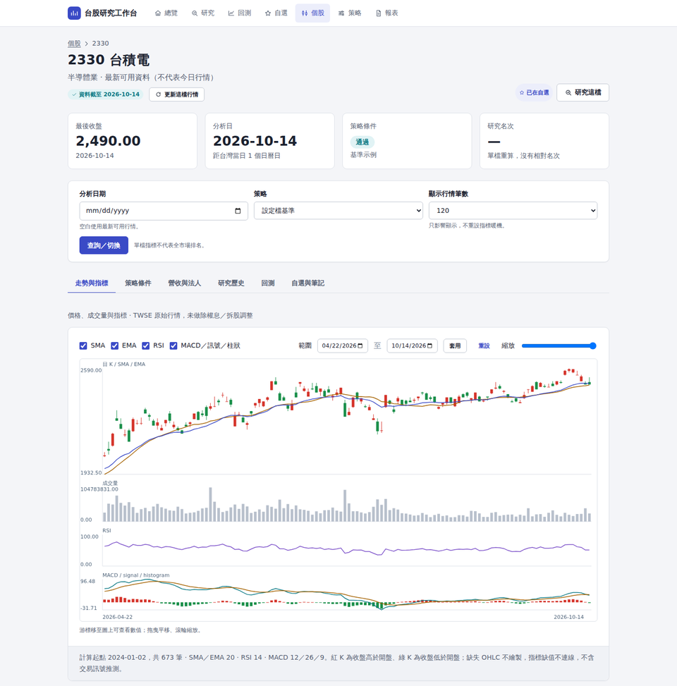
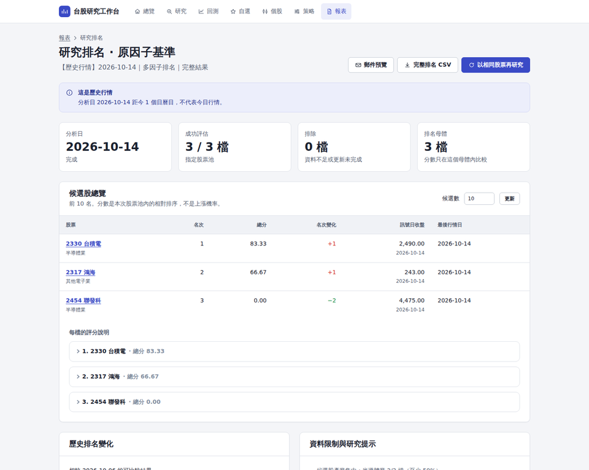
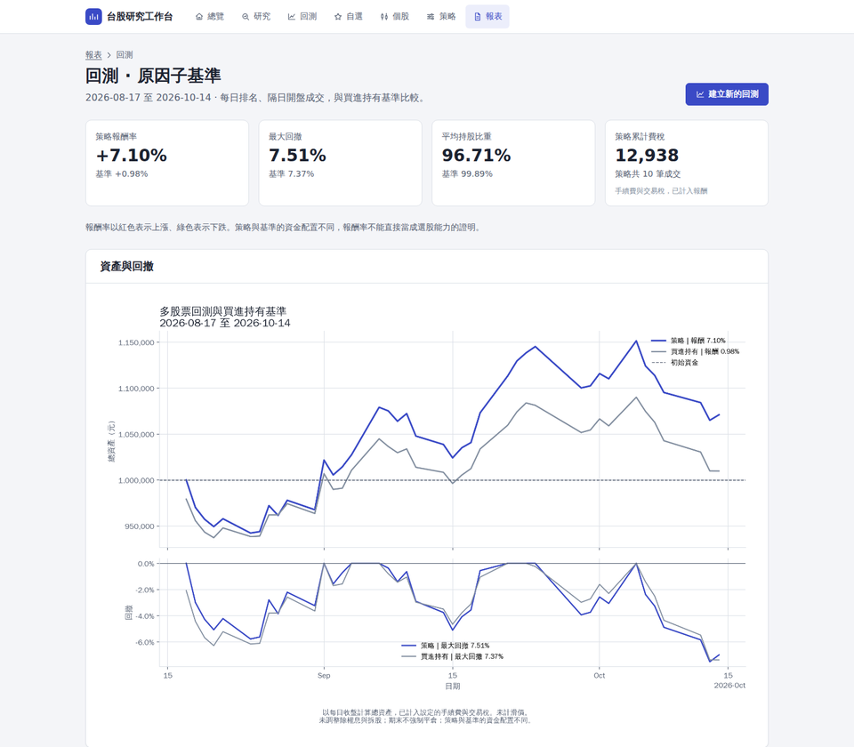
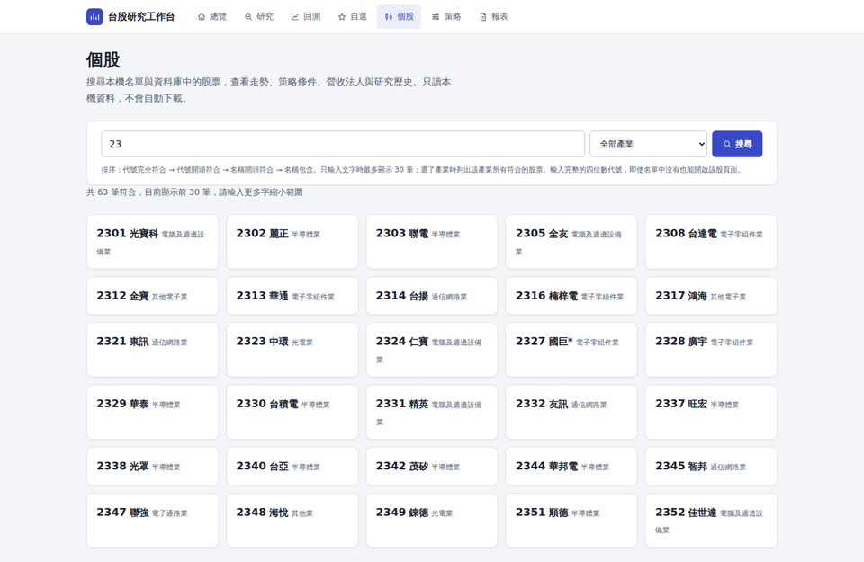
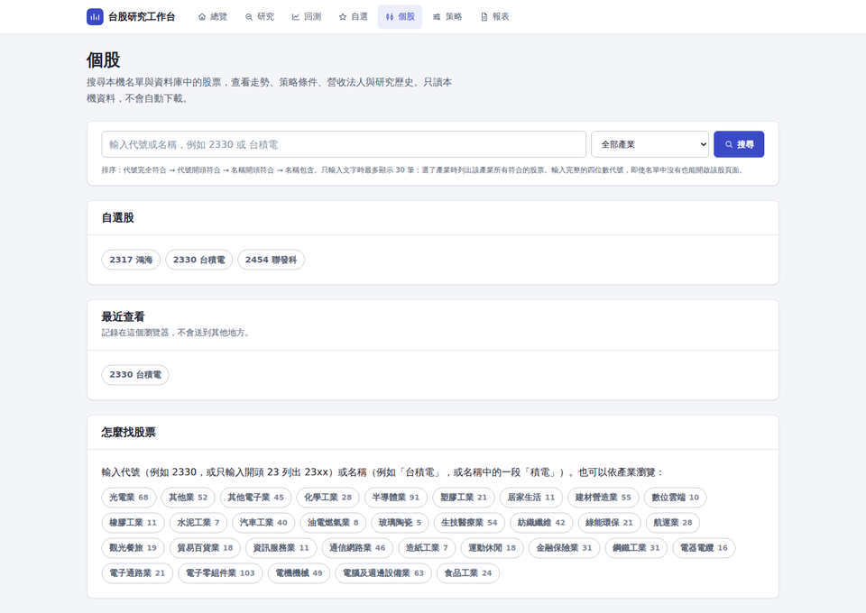
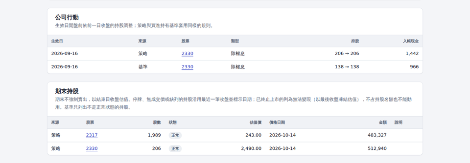
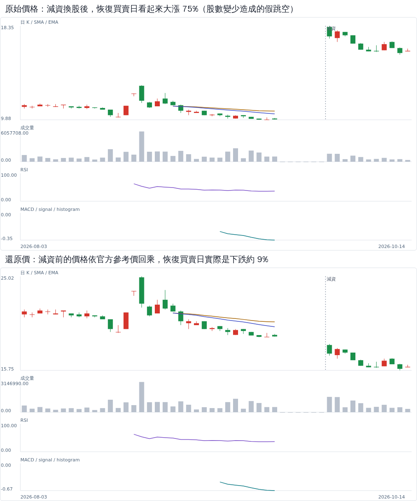
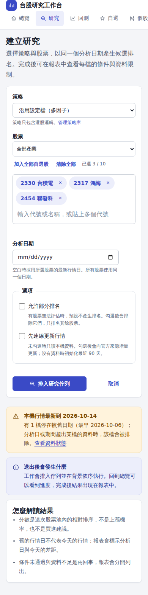

# 台股研究與回測工作台

[](https://github.com/kevinhuang-11/tw-stock-backtest/actions/workflows/ci.yml)

以官方公開資料做台股選股排名、歷史回測與自選股追蹤的本機工具。Python 抓取證交所行情與營收法人資料存進 SQLite，依策略產生候選排名、模擬多股票回測並與買進持有比較，所有結果都保存成不可覆寫的報表。重點是**不偷看未來資料、計入台股費稅、資料不足時直接說明**。

v1 版本供單人在本機使用；測試驗證的是軟體行為，不代表任何策略已證明能獲利。

**Python 3.12 · Flask · SQLite · Decimal · Matplotlib · 原生 JavaScript · unittest · GitHub Actions**

[操作導覽](docs/DEMO.md) · [操作與設計細節](docs/OPERATIONS.md) · [資料庫與 SQL](docs/SQL.md)

## 在自己的電腦上試用（離線示範）

下面的指令會在你自己的電腦上下載專案並啟動工作台；**執行之後**才能用瀏覽器開啟 `http://127.0.0.1:9000`，這不是公開網站。

Linux／macOS／WSL（需要 Python 3.12 與 git）：

```bash
git clone https://github.com/kevinhuang-11/tw-stock-backtest.git
cd tw-stock-backtest
python3.12 -m venv .venv
.venv/bin/python -m pip install -e .
.venv/bin/python examples/prepare_demo.py --serve
```

Windows：目前不支援在 Windows 上直接執行（工作台使用只有 Linux／macOS 才有的檔案鎖定模組 `fcntl`），請在 [WSL](https://learn.microsoft.com/windows/wsl/install) 裡執行上面的指令。

要停止時，在執行指令的終端機按 `Ctrl+C`。再次執行最後一行會沿用已建立的示範資料。

示範使用三檔合成股票，不需要網路、不讀取任何個人資料；示範環境中連網更新的按鈕會停用並說明原因。逐步走過自選總覽、個股頁、保存與比較快照、郵件預覽的導覽見 [操作導覽](docs/DEMO.md)。

改用真實資料時，先依 [操作指南](docs/OPERATIONS.md#真實資料準備) 下載行情，再以根目錄的 `config.toml` 啟動工作台：

```bash
.venv/bin/python -m tw_stock_backtest.cli.serve_workbench --port 9000
```

工作台只監聽本機，不會自行下載；還沒有資料時，首頁會說明從哪裡開始。設定檔中的資料庫相對路徑以設定檔所在目錄為基準。



## 技術亮點

- **不使用未來資料**：訊號以當日收盤計算、下一個行情日開盤成交；指標只看分析日以前的資料，有專門測試確認加入未來行情不會改變過去結果（[portfolio.py](src/tw_stock_backtest/backtesting/portfolio.py)、[test_factors.py](tests/test_factors.py)）。
- **計入台股成本**：手續費 0.1425%（最低 20 元、可設折扣）、賣出證交稅 0.3%、單邊滑價，全程以 `Decimal` 計算並依規則捨去（[costs.py](src/tw_stock_backtest/backtesting/costs.py)）。
- **資料品質優先於結果好看**：缺價不補零、不刪列湊窗口，未確認的缺漏不當成停牌；遞迴指標在缺價後重新暖機，無成交價與原因未確認的缺列當日不成交並在報表列出，而不是讓整次回測失敗；終止上市的持股列為無法變現；介面標示每檔資料截至哪天、落後幾個行情日。24 種停牌與缺價情況的規則與對應測試見 [docs/HALT-POLICY.md](docs/HALT-POLICY.md)。
- **資料庫端的資料品質檢查**：行情表依查詢方式加上日期索引與缺價部分索引（EXPLAIN QUERY PLAN 由 SCAN 變為 SEARCH）；以 `PRAGMA user_version` 做可重複執行的 schema 遷移；各股落後行情日數與行情缺口用 GROUP BY 與 `ROW_NUMBER`／`LAG` 視窗函式在 SQLite 中計算，並以測試確認與原本的 Python 結果完全一致。SQL 只處理日期、筆數與 NULL，價格仍以 `Decimal` 在 Python 計算（[docs/SQL.md](docs/SQL.md)）。
- **公司行動（除權息、減資、變更面額）**：從證交所公告下載並以官方公式核對參考價。指標用「截至分析日」的還原價，只套用已經生效的事件，不偷看未來；回測在生效日依前一日持股入帳股利、退還股款並調整股數，買進持有基準套用同樣的規則。以 2026 年 9 檔減資為例，原始價格會把 6550 恢復買賣當天的部位算成 +75.4%，調整後是 −8.9%。含現金增資的除權可設定為拒絕計算（預設）或放棄認購；放棄認購時報表另列稀釋損失（[OPERATIONS.md](docs/OPERATIONS.md#研究排名與更新)）。
- **可追查的報表**：每份研究與回測都固定保存當時的設定、股票池、輸入資料與策略 SHA-256，之後修改策略或更新資料都不會改變舊報表。
- **離線示範與連網防護**：合成示範名單會讓所有下載入口在發出請求前拒絕執行，測試以攔截網路函式確認（[test_offline_demo.py](tests/test_offline_demo.py)）。
- **不依賴前端框架與 CDN**：Flask＋Jinja＋原生 JS，自繪 SVG 圖示、系統字型；可鍵盤操作的股票選擇器，與個股搜尋頁共用同一套搜尋與排序（代號、名稱、產業）；台股慣例紅漲綠跌，狀態標籤刻意不用綠色以免與下跌混淆。
- **工程流程**：離線單元與整合測試、CI 以安裝後的套件從乾淨目錄執行測試，並以 ruff 檢查排版與 lint、以 mypy 嚴格檢查核心模組的型別（回測、指標、停牌與公司行動、股票搜尋）；核心模組不可匯入 CLI 由測試把關，重構以黃金輸出測試確認行為不變；Playwright 只在開發依賴，用來截圖與檢查瀏覽器互動（[tools/](tools/)）。

## 開發方式

本專案以 Codex 與 Claude Code 協作開發。[AGENTS.md](AGENTS.md) 與 [CLAUDE.md](CLAUDE.md) 記錄給 AI 工具的開發約定，例如不得使用分析日之後的資料、未經同意不檢視保留期間的績效、不自動下載全市場資料，以及修改後要跑的測試指令與專案架構說明。這些約定也適用於人工修改。

## 畫面

以下截圖使用本機真實行情（資料截至 2026-10-14，股票池為 2330、2317、2454；自選股是截圖用的暫存清單，沒有筆記），只展示功能，**不是投資建議或策略績效證明**。畫面上的「距今 8 個曆日」是以拍攝日 2026-10-22 計算。

| 自選股 | 個股 |
|---|---|
|  |  |

| 研究排名 | 回測報表 |
|---|---|
|  |  |

| 股票搜尋 | 依產業瀏覽 |
|---|---|
|  |  |

**回測的公司行動與期末持股**：除權息在生效日依前一日持股入帳現金，策略與買進持有基準套用同樣的規則；期末不強制賣出，以結束日收盤估值，停牌或缺價的持股會標出估值所用的價格日期。



**原始價格與還原價**：6550 在 2026-09 減資（每千股換發約 520 股），原始價格把恢復買賣日畫成大漲 75%；個股頁切換成還原價後，減資前的價格依官方參考價回乘，K 線與均線、RSI、MACD 一起改用同一口徑，恢復買賣日實際是下跌約 9%。



<details>
<summary>手機寬度：建立研究</summary>


</details>

## 功能一覽

- **官方資料整合**：TWSE 行情、上市普通股名單、月營收與法人買賣超；來源分開保存，支援修訂追查。
- **策略篩選與排名**：策略庫、RSI／MACD／突破等有限條件、多因子相對排名，保存有效設定與雜湊。
- **回測與比較**：多股票、費稅與滑價、買進持有基準；多策略、多期間採相同設定獨立模擬。
- **個股與自選研究**：依代號、名稱或產業搜尋（代號完全符合、代號開頭、名稱開頭、名稱包含依序排列）；價格／指標圖可切換原始價格與還原價；策略條件、營收與法人覆蓋；私人筆記與研究產物分離。
- **增量與背景更新**：月份規劃、有限重試、接續進度、背景佇列、取消與失敗診斷。
- **不可覆寫的研究快照**：保存所用數值與來源，區分條件改變、資料更新及同期間修訂。
- **共用報告內容**：HTML、純文字與郵件預覽共用摘要，CSV 不包含私人筆記。
- **工程驗證**：離線單元／整合測試、安裝套件測試與 GitHub CI；不需真實 API 或寄信憑證。

## 架構

```text
TWSE prices                    TWSE / IIH supplemental sources
     |                                      |
     v                                      v
cli/ + data/                 cli/update_supplemental + data/supplemental
     |                                      |
     v                                      v
SQLite: stock_prices           SQLite: source-separated supplemental
     |                                      |
     v                                      |
strategies + analysis                       |
     |                                      |
     +--> backtesting --> reporting         |
     |                       |              |
     +--> saved rankings ----+--------------+
                             |
                             v
                    watchlist_research
                    values + snapshots
                             |
                             v
                 research_digest / notifications
                    HTML / text / CSV / preview

Workbench (Flask) / CLI: controlled jobs, queries and report access
Private notes SQLite: workbench only; excluded from report exports
```

這張圖要表達的是資料的流向：來源 → 分開儲存 → 共用的分析與研究核心 → 固定的報告，而不是資料夾清單。
圖中有兩條線刻意不存在：

- 營收與法人目前只供研究展示，**不送入排名或回測引擎**。
- 私人筆記只留在工作台，不會進入任何匯出的報告。

工作台與 CLI 呼叫共用核心，沒有另外實作一套交易模擬。

## 資料來源

| 來源 | 用途與界線 |
|---|---|
| [TWSE 月行情](https://www.twse.com.tw/zh/trading/historical/stock-day.html) | OHLC、量與成交資訊；用於技術研究及回測。原始價格保存不變，指標可依公司行動還原 |
| [TWSE OpenAPI](https://openapi.twse.com.tw/) | 上市公司最新月營收快照；無任意歷史年月參數 |
| [TWSE IIH](https://wwwc.twse.com.tw/IIH2/zh/company/financial.html?code=2330) | 滾動歷史月營收；原單位元，精確換算千元，不與其他來源拼接分母 |
| [TWSE T86](https://www.twse.com.tw/zh/trading/foreign/t86.html) | 法人買進／賣出／淨額，單位股；依本機行情日期檢查累計覆蓋 |

## 設計決策

1. **來源與修訂分開追查**：不同營收來源獨立保存；同一資料鍵的來源／單位衝突拒絕覆蓋，修訂保存舊值。
2. **保存快照而非回查最新設定**：有效策略與數值隨報表保存；完成前使用 `.incomplete` 目錄，過去快照不因修改策略而改變。
3. **隔離補充資料失敗**：營收或法人失敗仍可查看行情與策略；缺值不補零，更新結果與可用數值分開呈現。
4. **共用摘要呈現**：網頁與郵件預覽使用同一份結構化摘要與呈現函式，避免兩套文字規則不一致。

## 測試

```bash
# 完整測試；結尾的 "Ran N tests" 會顯示實際執行的項數
.venv/bin/python -m unittest discover -s tests -v

# 只跑一個測試檔
.venv/bin/python -m unittest discover -s tests -p 'test_portfolio_backtest.py' -v

# 只跑名稱符合的測試
.venv/bin/python -m unittest discover -s tests -k future -v

# 排版、lint 與型別檢查（需先安裝 dev 依賴：pip install -e '.[dev]'）
.venv/bin/ruff format --check
.venv/bin/ruff check
.venv/bin/mypy              # 只檢查 pyproject.toml [tool.mypy] 列出的模組
```

測試全部離線執行，不需要網路或任何憑證。涵蓋範圍包含未來資料隔離、策略與交易成本、資料修訂、快照比較與安全邊界；停牌規則的每個情況都有對應測試（`tests/test_halt_policy.py` 與 [HALT-POLICY.md](docs/HALT-POLICY.md) 的編號一一對照），`tests/test_module_layers.py` 確認核心模組不匯入 CLI，`tests/test_golden_outputs.py` 記錄回測與 CLI 的完整輸出供重構比對。

CI 以 ruff 檢查排版與 lint、以 mypy 檢查型別，並在乾淨的 runner 上安裝套件後執行同一組測試。另有一個研究 workflow 會取得行情並產出排名，只能在 GitHub Actions 頁面手動觸發，沒有排程。

## 專案結構

```text
src/tw_stock_backtest/
  cli/                 執行入口與更新流程
  data/                官方資料解析與持久化
  analysis/            指標、篩選與評分
  backtesting/         成交、資金、成本及基準
  templates/ static/   本機工作台介面
  *research*.py        研究流程、摘要與快照
  reporting.py         報表輸出
strategies/            少量示例策略
examples/              隔離的離線展示準備
tools/                 開發用：截圖與瀏覽器互動檢查（需 dev 依賴）
tests/                單元、整合與安全測試
docs/                 操作導覽、操作與設計細節、README 截圖
```

根目錄 `data/`、`reports/` 與私人 state 屬本機產物，不納入 Git；`src/.../data/` 是必要原始碼，會公開。

## 限制

- 三檔 IIH 實測歷史為 **2025-09～2026-09，共 13 個月**；可展示最近 12 月，但不是任意年份歷史，年增率仍可能缺少精確對應期。
- 缺少明確公告時間及完整口徑資訊；現在取得的修訂值不是完整的歷史當時可知資料（point-in-time）。
- 法人累計的筆數不足時如實顯示不足，不把缺少的日子當成零（離線示範刻意只放 17 筆，用來呈現 20 日累計不足）；沒有獨立交易日曆，不把日曆日落差當成缺漏交易日。
- 目前上市股票池存在倖存者偏差：已下市的股票不在名單內（已查證的終止上市案例列在停牌清單，但沒有它們的行情）。回測開始日之後才上市、或開始日以前已終止上市的股票會排除並在報表列出，不在上市後中途加入。
- 成交以日線開盤價簡化模擬：不模擬漲跌停鎖死（開盤即漲跌停仍會成交）與盤中暫停交易；處置股與全額交割只標示、不模擬交易限制。停牌、缺價與交易限制的完整規則見 [docs/HALT-POLICY.md](docs/HALT-POLICY.md)。
- 公司行動調整是簡化：股利在除息日入帳（實際發放日較晚）、不扣稅、面額假設為 10 元；含現金增資的除權預設不跨過還原、回測持有跨過時拒絕計算，可設定 `rights = "decline"` 改為放棄認購，「認購」尚未支援；只涵蓋已下載公司行動資料的期間，報表會列出未涵蓋的部分。
- 自動化測試涵蓋到 HTTP 層（Flask 測試用戶端）。瀏覽器端另有 Playwright 腳本，檢查股票選擇器與股票搜尋的互動（含手機寬度與沒有 JavaScript 時的退路）並產生截圖；它需要開發依賴、手動執行，**不在 CI 中**，也沒有視覺回歸比對。
- 工作台未設計為公開或多人服務。

## 後續方向

- 補足可追查公告時間與修訂版本的歷史資料。
- 加入交易日曆，改善研究期間的完整性判定。
- 把瀏覽器互動檢查納入 CI，並加入視覺回歸測試。
- 現金增資的「認購」模式（付款取得新股）；目前可選拒絕計算或放棄認購。
- 模擬漲跌停鎖死（依漲跌停價判斷開盤能否成交）與盤中暫停交易。
- 視使用需求提供容器化的本機安裝方式。
