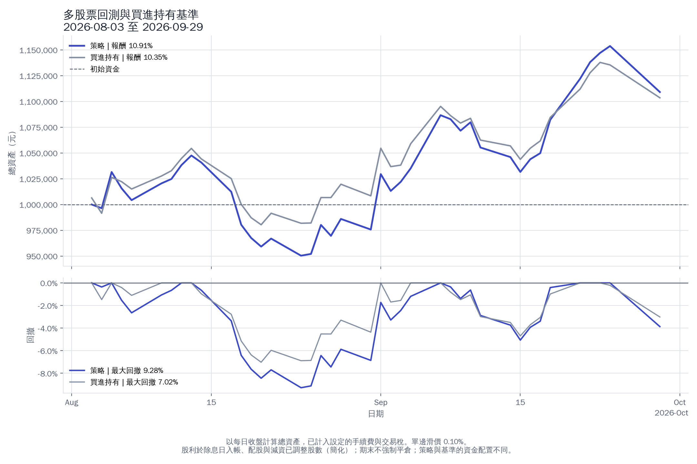

# TW Stock Research & Backtesting Workbench

## Overview

以 Python 建立的台股資料研究與回測工作台，串接官方資料取得、SQLite 儲存、策略篩選與排名、歷史模擬及研究報告。
使用者可從候選股進入個股研究、自選總覽，保存研究快照並比較相容的前次結果。
工程重點是**可重複執行、能追查來源與設定、能說明資料不足的研究流程**。
Portfolio v1 提供單人本機操作；測試驗證軟體行為，不代表策略已證明能獲利。

**Python 3.12 · Flask · SQLite · Decimal · Matplotlib · unittest · GitHub Actions**

[操作導覽](docs/DEMO.md) · [操作與設計細節](docs/OPERATIONS.md)

## Key Features

- **官方資料整合**：TWSE 行情、上市普通股名單、月營收與法人買賣超；來源分開保存，支援修訂追查。
- **策略篩選與排名**：策略庫、RSI／MACD／突破等有限條件、多因子相對排名，保存有效設定與雜湊。
- **回測與比較**：多股票、費稅與滑價、買進持有基準；多策略、多期間採相同設定獨立模擬。
- **個股與自選研究**：價格／指標圖、策略條件、营收與法人覆蓋；私人筆記與研究產物分離。
- **增量與背景更新**：月份規劃、有限重試、接續進度、背景佇列、取消與失敗診斷。
- **不可覆寫的研究快照**：保存所用數值與來源，區分條件改變、資料更新及同期間修訂。
- **共用報告內容**：HTML、純文字與郵件預覽共用摘要，CSV 不包含私人筆記。
- **工程驗證**：離線單元／整合測試、安裝套件測試與 GitHub CI；不需真實 API 或寄信憑證。

## Architecture

```text
TWSE prices                    TWSE / IIH supplemental sources
     |                                      |
     v                                      v
cli/ + data/                 cli/update_supplemental + data/supplemental
     |                                      |
     v                                      v
SQLite: stock_prices           SQLite: source-separated supplemental
     |                                      |
     v                                      |
strategies + analysis                       |
     |                                      |
     +--> backtesting --> reporting         |
     |                       |              |
     +--> saved rankings ----+--------------+
                             |
                             v
                    watchlist_research
                    values + snapshots
                             |
                             v
                 research_digest / notifications
                    HTML / text / CSV / preview

Workbench (Flask) / CLI: controlled jobs, queries and report access
Private notes SQLite: workbench only; excluded from report exports
```

這張圖要表達的是資料的流向：來源 → 分開儲存 → 共用的分析與研究核心 → 固定的報告，而不是資料夾清單。
圖中有兩條線刻意不存在：

- 營收與法人目前只供研究展示，**不送入排名或回測引擎**。
- 私人筆記只留在工作台，不會進入任何匯出的報告。

工作台與 CLI 呼叫共用核心，沒有另外實作一套交易模擬。

## Example Workflow

準備／更新官方資料 → 執行策略 → 檢視候選排名 → 加入自選 → 查看個股與補充資料 → 保存快照 → 比較相容前次 → 開啟 HTML／郵件預覽。

## Quick Start

WSL2 Ubuntu 24.04／Python 3.12。在專案根目錄執行；已有 `.venv` 不需重建：

```bash
python3.12 -m venv .venv
.venv/bin/python -m pip install -e .
.venv/bin/python -m tw_stock_backtest.cli.serve_workbench --port 9000
```

開啟 **http://127.0.0.1:9000**。只有本機 loopback 監聽；無資料時顯示空狀態，不自動下載。主要入口：`/watchlist`、`/stocks`、`/strategies`。

新環境可依 [DEMO](docs/DEMO.md) 建立**無網路、無私人資料的合成範例**；使用真實資料的準備方式見 [操作指南](docs/OPERATIONS.md#真實資料準備)。資料庫相對路徑以設定檔所在目錄為基準。

## Demo

[操作導覽](docs/DEMO.md) 帶你用離線的合成資料走一遍：啟動 → 自選總覽 → 個股頁 → 保存與比較快照 → HTML 與郵件預覽。

以下是既有歷史回測匯出的圖表，**不是工作台截圖，也不是合成範例的績效**。假設見圖注；只展示報表能力。



## Data Sources

| 來源 | 用途與界線 |
|---|---|
| [TWSE 月行情](https://www.twse.com.tw/zh/trading/historical/stock-day.html) | OHLC、量與成交資訊；用於技術研究及回測，原始價格未調整除權息／拆股 |
| [TWSE OpenAPI](https://openapi.twse.com.tw/) | 上市公司最新月營收快照；無任意歷史年月參數 |
| [TWSE IIH](https://wwwc.twse.com.tw/IIH2/zh/company/financial.html?code=2330) | 滾動歷史月營收；原單位元，精確換算千元，不與其他來源拼接分母 |
| [TWSE T86](https://www.twse.com.tw/zh/trading/foreign/t86.html) | 法人買進／賣出／淨額，單位股；依本機行情日期檢查累計覆蓋 |

## Design Decisions

1. **來源與修訂分開追查**：不同營收來源獨立保存；同一資料鍵的來源／單位衝突拒絕覆蓋，修訂保存舊值。
2. **保存快照而非回查最新設定**：有效策略與數值隨報表保存；完成前使用 `.incomplete` 目錄，過去快照不因修改策略而改變。
3. **隔離補充資料失敗**：營收或法人失敗仍可查看行情與策略；缺值不補零，更新結果與可用數值分開呈現。
4. **共用摘要呈現**：網頁與郵件預覽使用同一份結構化摘要與呈現函式，避免兩套文字規則不一致。

## Testing

```bash
.venv/bin/python -m unittest discover -s tests -v
```

共 372 項測試，全部離線執行，不需要網路或任何憑證。涵蓋範圍包含未來資料隔離、策略與交易成本、資料修訂、快照比較與安全邊界。

CI 會在乾淨的 runner 上安裝套件，再執行同一組測試。另有一個研究 workflow 會取得行情並產出排名，它的定時執行預設關閉。

## Project Structure

```text
src/tw_stock_backtest/
  cli/                 執行入口與更新流程
  data/                官方資料解析與持久化
  analysis/            指標、篩選與評分
  backtesting/         成交、資金、成本及基準
  templates/ static/   本機工作台介面
  *research*.py        研究流程、摘要與快照
  reporting.py         報表輸出
strategies/            少量示例策略
examples/              隔離的離線展示準備
tests/                單元、整合與安全測試
docs/                 展示、操作與作品說明
```

根目錄 `data/`、`reports/` 與私人 state 屬本機產物，不納入 Git；`src/.../data/` 是必要原始碼，會公開。

## Limitations

- 三檔 IIH 實測歷史為 **2025-09～2026-09，共 13 個月**；可展示最近 12 月，但不是任意年份歷史，年增率仍可能缺少精確對應期。
- 缺少明確公告時間及完整口徑資訊；現在取得的修訂值不是完整的歷史當時可知資料（point-in-time）。
- 法人 20 日示例只有 17 筆時如實顯示不足；沒有獨立交易日曆，不把日曆日落差當成缺漏交易日。
- 目前上市股票池存在倖存者偏差；價格未調整公司行動，成交為簡化模擬。
- 已做 HTTP／整合驗證，**尚未完成瀏覽器桌面及窄螢幕 E2E**。工作台未設計為公開或多人服務。

## Future Work

- 補足可追查公告時間與修訂版本的歷史資料。
- 加入交易日曆及公司行動資料，改善研究期間的完整性判定。
- 建立瀏覽器操作與視覺回歸測試。
- 視使用需求提供容器化的本機安裝方式。
